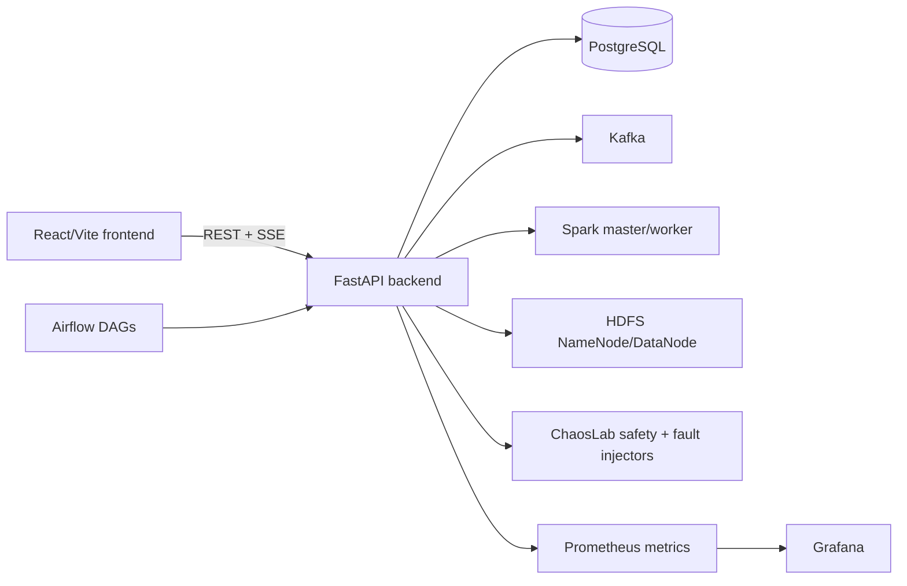

# Architecture

ChaosFlow has three application layers and a deliberately explicit research
observation boundary.

## Components

- `backend/app/pipeline/` parses YAML, validates schemas, builds execution
  plans, runs pandas or Spark branches, and emits progress events.
- `backend/app/plugins/` contains source, processor, and storage plugins.
- `backend/app/reliability/` contains experiment contracts, safety gates,
  Docker-backed fault injectors, recovery observation, and reports.
- `spark-jobs/` contains the batch and Structured Streaming entry points used
  by Spark containers.
- `frontend/src/` is the authenticated React application for pipeline authoring,
  execution, progress, reports, and reliability experiments.
- `airflow/dags/` contains orchestration boundaries that call the backend API;
  Airflow is not an independent scientific oracle.
- `infrastructure/` contains monitoring and optional Hive/Flink configuration.

## Runtime topology

The default Compose topology uses one Kafka broker, one Spark worker, one HDFS
DataNode, PostgreSQL, Airflow, Prometheus, Grafana, FastAPI, and the frontend.
This is a development/research topology, not a highly available production
cluster. HDFS replication is configured as one in the default stack.

## Evidence boundary

The platform's health, progress, and native validation signals are operational
telemetry. Research claims use retained protocol records and an independent
typed full-row multiset oracle. A successful container probe or application
terminal status is never silently promoted to an exact-correctness claim.
