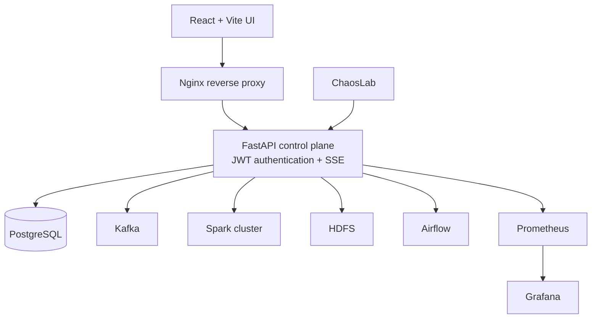
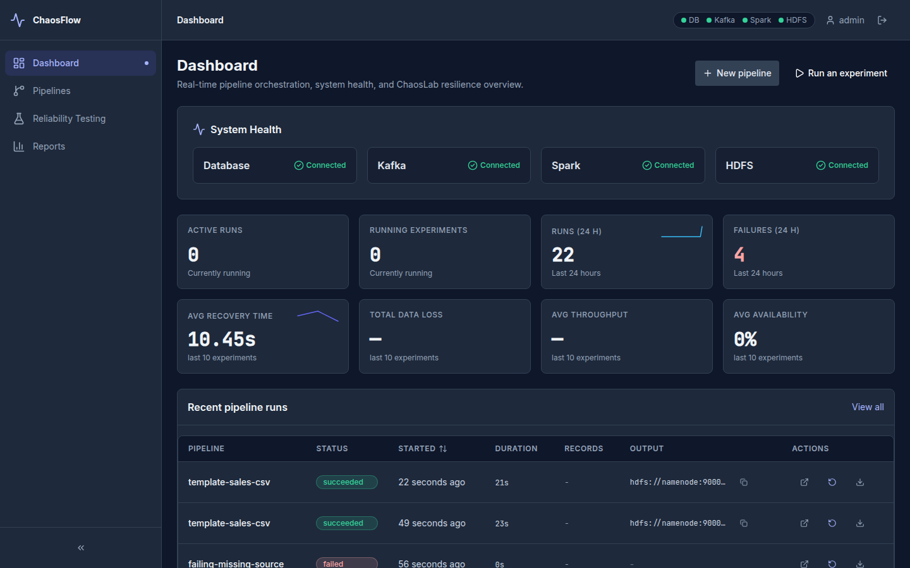
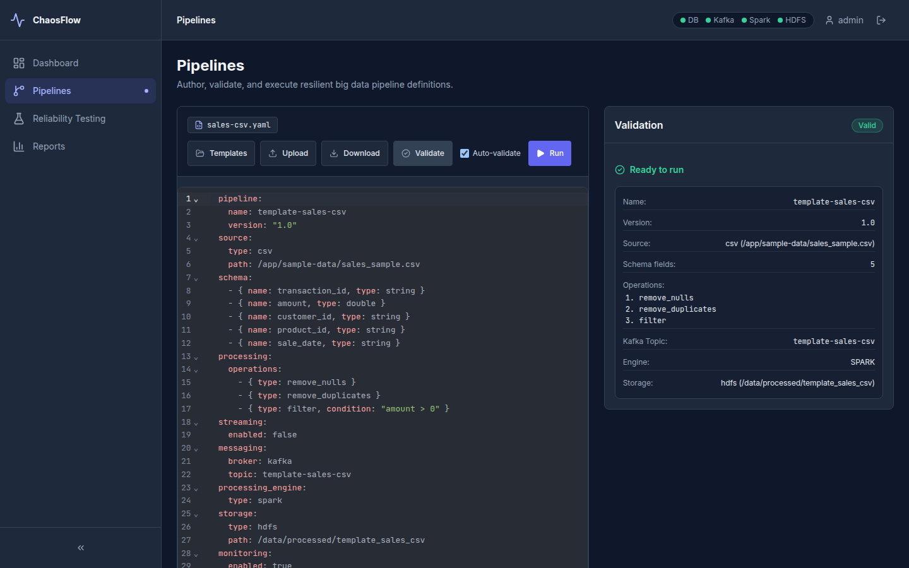
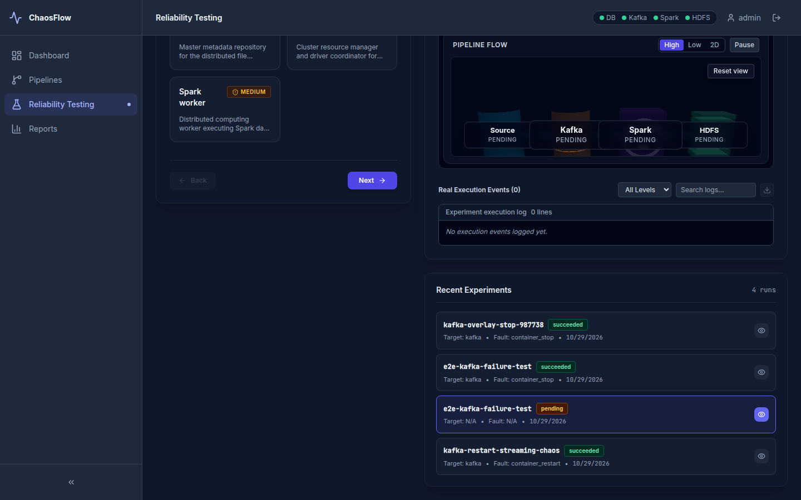

# Recovery Is Not Correctness: ChaosFlow

## A Configuration-Driven Resilient Big Data Pipeline Platform

ChaosFlow is the implemented software platform. **Recovery Is Not
Correctness** is the research theme used to study whether infrastructure and
executor recovery are followed by continued application progress, throughput
recovery, and exact data correctness.

This repository contains the platform, bounded experiment definitions, compact
research evidence, and reproducibility material. The evidence is a corrected,
single-host measurement case study. It does not establish universal
exactly-once processing, physical durability, independent-host replication, or
performance superiority.

## Overview

ChaosFlow authors, validates, runs, observes, and stress-tests declarative big
data pipelines under controlled infrastructure faults. It combines a FastAPI
control plane, a React UI, Kafka messaging, Spark processing, HDFS storage,
Airflow scheduling, and the ChaosLab reliability engine.

## Research Motivation

A service becoming healthy after a fault is not the same as an application
producing the correct result. The project therefore records fault exposure,
service health, executor recovery, source drain, application progress,
throughput, terminal state, sink visibility, and typed full-row correctness as
separate observations.

The terms are intentionally not interchangeable:

- **Infrastructure recovery**: a failed container or network condition returns
  to an intended operational state.
- **Executor recovery**: a Spark executor or worker becomes available again.
- **Application progress**: the pipeline advances through its workload and
  reaches the expected processing milestones.
- **Throughput recovery**: processing rate returns toward the measured
  baseline; this is a performance signal, not a correctness proof.
- **Exact data correctness**: the typed, full-row output matches the expected
  oracle, including multiplicity and ordering rules defined by the protocol.
- **Physical durability**: independently witnessed persistence on physical
  storage; it was not observable in this testbed.

## Research Contributions

The defensible contribution is an auditable measurement method that separates
recovery signals from end-to-end correctness. ChaosFlow also provides
configuration-driven fault experiments, explicit failure-closed classifications,
correction supersession records, and compact claim-to-evidence mappings.

## System Architecture

PipeForge is the declarative pipeline path. It validates YAML, coordinates
Kafka/Spark/HDFS processing, and records progress and output metadata. ChaosLab
is the reliability control plane: it validates bounded faults against the
isolated Compose testbed and records recovery and correctness evidence.



## Technology Stack

- Python 3.11, FastAPI, SQLAlchemy, Alembic, and pytest.
- React 18, TypeScript, Vite, Tailwind CSS, Three.js, and Vitest.
- Apache Kafka, Apache Spark 3.5, Hadoop HDFS, and Airflow.
- PostgreSQL, Docker Compose, Prometheus, Grafana, and Nginx.

## Main Platform Components

- `backend/`: authenticated API, pipeline execution, messaging, storage,
  reliability, metrics, and database migrations.
- `frontend/`: pipeline authoring, topology, run details, reports, and
  reliability views.
- `spark-jobs/`: batch, streaming, topology, and controlled non-idempotent
  processing jobs.
- `airflow/`: container image and scheduler integration.
- `experiments/` and `backend/app/reliability/`: bounded fault definitions and
  ChaosLab controls.
- `research_artifacts/`: compact corrected evidence and reproducibility
  indexes; large historical run trees are intentionally excluded.

## Key Features

- Declarative YAML pipeline authoring and validation.
- Kafka, Spark, HDFS, and Airflow integration.
- Live run progress and operational metrics.
- Safety-validated container and network fault injection.
- Failure-closed experiment classification.
- Exact-oracle comparison that preserves legitimate row multiplicity.
- Reproducibility-oriented evidence catalogs and correction maps.

## Installation Requirements

- Linux or macOS, or Windows with Docker Desktop and the PowerShell helper.
- Docker Engine and Docker Compose v2 with at least 8 GB RAM available to the
  stack.
- Python 3.11 for local scripts and tests.
- Node.js/npm for frontend validation.
- At least 20 GB free disk space for images, volumes, and generated test data;
  research campaigns require substantially more and are not part of the quick
  start.

## Quick Start

```bash
cp .env.example .env
# Edit .env and replace every required placeholder.
docker compose --env-file .env config --quiet
docker compose --env-file .env up -d --build
docker compose --env-file .env ps
```

On Windows, use `scripts/setup-env.ps1` to create local configuration. Never
commit `.env`; it is ignored by Git. The required Airflow Fernet key,
PostgreSQL passwords, JWT secret, administrative password, and Grafana
password must be supplied through the environment. Missing required sensitive
values fail closed during configuration validation.

Useful local endpoints after startup include the frontend at
`http://localhost:3000`, FastAPI documentation at `http://localhost:8000/docs`,
Spark UI at `http://localhost:8080`, HDFS NameNode UI at
`http://localhost:9870`, Airflow at `http://localhost:8081`, Prometheus at
`http://localhost:9090`, and Grafana at `http://localhost:3001`.

## Configuration

`.env.example` is a placeholder-only reference. Review it together with
`CONFIGURATION.md` before startup. Keep production secrets in an approved
secret store or protected runtime environment. The Docker socket used by
ChaosLab is a privileged development capability and must not be exposed to an
untrusted multi-tenant deployment.

## Running Pipelines

1. Start the Compose services and verify health with `docker compose ps`.
2. Open the frontend and select or author a YAML pipeline.
3. Validate the pipeline before submission.
4. Submit the run and inspect progress, logs, metrics, and output metadata.
5. Compare output with the appropriate oracle when performing an experiment.

The sample inputs are under `sample-data/`. The large generated sales dataset
is intentionally ignored; create it locally only when a selected test needs
it:

```bash
python3 scripts/generate_sales_data.py --rows 1000000
```

## Fault Injection and Recovery Experiments

ChaosLab supports bounded `container_stop`, `container_restart`,
`network_latency`, `network_packet_loss`, `cpu_burn`, and `memory_stress`
experiments against approved services such as Kafka, the Spark worker, and the
DataNode. Safety validation rejects forbidden targets and concurrent unsafe
experiments. Experiment definitions are in `experiments/`.

Do not treat a service health transition or executor restart as an exactness
result. The research protocol requires a terminal status, source-drain
accounting, sink observation, and typed full-row oracle comparison.

## Testing

The following commands correspond to components in this repository:

```bash
# Frontend
cd frontend
npm ci
npm run lint
npm test -- --run
npm run build

# Backend, from the repository root, with the backend container available
cd ..
docker exec platform-backend pytest -q -m 'not integration'

# Compact research-evidence integrity check
sha256sum -c research_artifacts/SHA256_MANIFEST.txt
```

Integration, Playwright, fault-injection, and resource-intensive campaign
tests require additional services or resources. Their current validation
status is recorded below and in the publication audit; they are not silently
represented as passing.

## Research Results

The corrected authoritative populations are:

| Condition | Corrected result |
|---|---|
| N1 interruption | 13 exact-correct outcomes among 16 executable fault attempts; three recovered-incorrect historical observations remain separate. |
| N2 latency and N3 packet loss | 12 valid matched pairs per condition. |
| Worker recovery | 12 completed valid v2 observations, 12 exact-correct; mean `T_confirm` approximately 83.788 seconds. `T_confirm` is qualifying-window end minus worker-restore timestamp, not the 30-second window duration. |
| Producer duplicate mitigation | 24 valid observations; 20 exact-oracle passes and 4 incorrect original-producer observations. |
| Replicated HDFS | R0: 6/6 exact-correct; R1: 0/6 exact-correct with failure-closed behavior; R2: 5/6 exact-correct and one incomplete observation. |
| Native Spark comparison | 24 corrected-valid runs, six matched pairs per condition; no statistically established performance-superiority claim. |

The evidence preserves negative, incomplete, and failure-closed outcomes. See
`RESEARCH_RESULTS.md`, `research_artifacts/MASTER_RESEARCH_RESULTS.csv`,
`research_artifacts/MASTER_ATTEMPT_ACCOUNTING.csv`, and
`research_artifacts/EVIDENCE_CATALOG.csv`.

## Research Artifacts / Data Availability

The curated, checksum-indexed public evidence is published separately as the
Zenodo dataset [ChaosFlow: Configuration-Driven Resilient Big Data Pipeline
Platform — Consolidated Research Evidence](https://zenodo.org/records/24325138),
with version DOI [10.5281/zenodo.24325138](https://doi.org/10.5281/zenodo.24325138).
The deposited file is `ChaosFlow_Research_Artifacts_FINAL.zip` with SHA-256
`11788da06068a1ab5ebf253d3d9aebd8920d4b549487cc5248d024fa0b4db986`.

The deposit contains curated, checksum-indexed public evidence and
reproducibility material. Full private campaign logs are not part of the
public deposit, and the public archive excludes synthetic E1--E8 planning
material. The deposit does not claim full independent-host reproduction,
physical durable-media commit, or universal exactly-once behavior.

Dataset citation:

```text
Elshaboury, M. A. (2026). ChaosFlow: Configuration-Driven Resilient Big Data Pipeline Platform — Consolidated Research Evidence [Data set]. Zenodo. https://doi.org/10.5281/zenodo.24325138
```

## Reproducibility

Start with `REPRODUCIBILITY.md` and the protocol indexes under
`research_artifacts/`. The compact repository evidence is sufficient to trace
claims to selected artifacts, but it is not a replacement for the excluded
historical raw-run archives. The R2 correction tests replay preserved logs and
fixtures; they are not a new live fault rerun.

## Known Limitations

- Physical durability is `NOT_OBSERVABLE`.
- Independent-host reproduction is `NOT_EXECUTED`.
- Independent sink recovery is `NOT_EXECUTED`.
- The expanded benchmark is resource-limited.
- Full browser E2E execution was not completed in the publication audit.
- The default topology is single-host, container-scoped, and not equivalent to
  a production multi-host cluster.
- Replicated-HDFS observations are separate owned topologies, not proof of
  production storage durability.

These are scientific scope boundaries and findings, not software-validation
failures.

## Project Structure

```text
backend/             FastAPI application, migrations, and tests
frontend/            React/TypeScript application and tests
airflow/             Airflow image and requirements
spark-jobs/          Spark processing jobs
experiments/         Declarative experiment definitions
infrastructure/      Monitoring and service configuration
research_artifacts/  Compact corrected evidence and indexes
sample-data/         Small reproducible sample inputs
scripts/              Local setup and data-generation helpers
```

## Citation

Use the metadata in [`CITATION.cff`](CITATION.cff) for the software citation.
The separately published research dataset citation and data-availability scope
are documented in the Research Artifacts / Data Availability section above.

## License and Software Attribution

ChaosFlow is released under the MIT License. The public software attribution
is **ChaosFlow Contributors**, as recorded in `LICENSE` and `CITATION.cff`.
The accompanying academic manuscript has its own approved author block and is
not modified by this software release preparation.

## Visual Reference

The repository includes selected, existing interface captures for orientation;
they are not claims of a live deployment:






